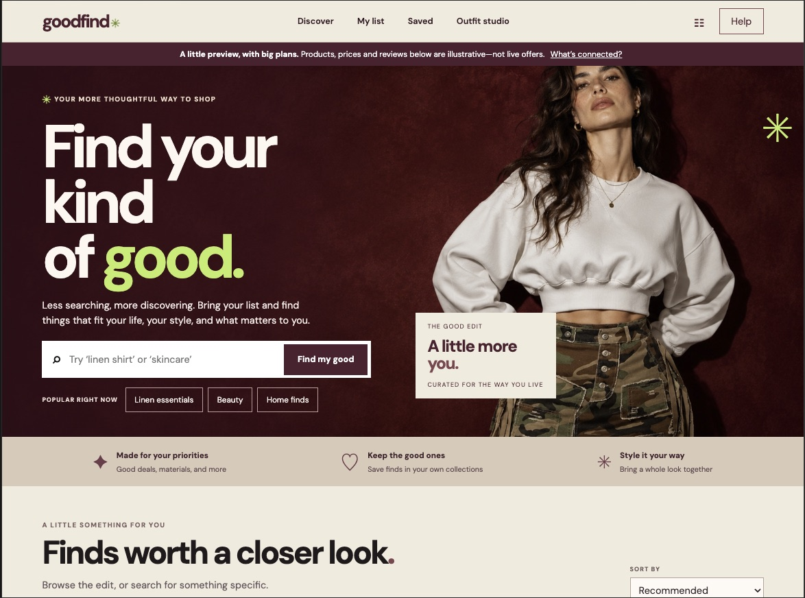

# Goodfind ✳

**Find your kind of good.**

A shopping discovery demo that brings ideas from multiple retailers into one space. Explore sample finds, build a shopping list, compare options, organize favorites, and put together a look.

**Work in progress, check back soon.**



The mobile and feature screenshots are coming soon.

## The experience

Goodfind is designed for the moment before checkout. A shopper can start with an idea, compare possible matches, save products for later, and follow a retailer link when ready. Store grouping makes it easier to see which saved finds might be purchased together.

The catalog, prices, ratings, sizes, delivery estimates, and retailer listings in the demo are illustrative. Sample retailer links open a store search and do not represent verified product offers. Live search is optional and requires a separate provider key.

## ✨ Current features

- **Discover:** Browse sample fashion, beauty, home, and accessory listings; filter by category or retailer; sort the demo catalog.
- **Search:** Find sample catalog matches from the main search or from an individual shopping-list item. When configured, the search also requests Google Shopping results via SerpApi and displays them in the page.
- **Compare:** Select up to three sample listings and compare their available details. Unknown values remain labeled as unknown.
- **Shopping lists:** Add multiple items, mark items complete, search for matches, expand the list into a modal, and save named list snapshots in the browser.
- **Favorites and collections:** Save sample products, create and manage collections, and view saved products grouped by retailer with sample subtotals.
- **Outfit studio:** Add pieces, preview their images together, and save the look as a collection.
- **Preferences:** Choose a shopping priority and interests. A single demo profile is stored locally in SQLite, and the demo feed gives selected categories priority.
- **Responsive interface:** A mobile-friendly layout, keyboard-accessible controls, and reduced-motion support.

## 🗺️ Planned features

- Authenticated user accounts and separate profiles with cross-device syncing.
- Persisted shopping lists, saved products, collections, and outfits associated with an account.
- Broader live retailer coverage, product matching, and more reliable price and delivery comparisons.
- Location-aware shipping and verified nearby stock when a source supports them.
- Review comparison across sources and clearer product attribute details.
- Material, ingredient, and sustainability preferences backed by reliable product information.
- Personalized outfit suggestions, saved searches, and price-drop notifications.
- Retailer grouping that considers actual shipping rules and product availability.

A cart and checkout are outside the current demo. Purchases take place on retailer sites.

## 🛠️ Technology

| Area | Technology |
| --- | --- |
| Frontend | HTML5, CSS3, vanilla JavaScript |
| Local backend | Python 3 standard library HTTP server |
| Demo database | SQLite |
| Local browser data | localStorage |
| Optional shopping results | SerpApi Google Shopping API |
| Testing | Python unittest and Node.js built-in assertions |

## Getting started

### Requirements

- Python 3.9 or newer.
- Node.js for the JavaScript catalog checks.
- An internet connection for remote sample images and optional shopping search.

No package installation is required for the local demo.

### Run the app

```bash
cd Goodfind
python3 server.py
```

Open [http://127.0.0.1:8011](http://127.0.0.1:8011). Keep the terminal running while you explore the app. Press Control-C to stop it.

To use a different port, set `PORT` when starting the server:

```bash
PORT=8012 python3 server.py
```

### Optional: enable live shopping search

1. Obtain a SerpApi API key and review the provider's pricing and terms.
2. In the terminal, set the key before starting the server. Replace the placeholder locally and do not commit your key:

   ```bash
   export SERPAPI_API_KEY='YOUR_KEY_HERE'
   ```

3. Start `python3 server.py` in the same terminal, then enter a search in Goodfind.

The key is read by the server, not embedded in the browser code. The key lasts for the terminal session. Provider coverage, merchant links, images, prices, and shipping details may vary or be unavailable. Sample search works without a key.

| Variable | Required | Purpose |
| --- | --- | --- |
| `SERPAPI_API_KEY` | No | Enables live shopping search. |
| `PORT` | No | Sets the local server port; defaults to `8011`. |
| `GOODFIND_DB_PATH` | No | Overrides the local SQLite database path. |

## Data model

### Implemented today

The local SQLite database contains one `profile` record with `id` and `preferences` fields. Preferences are stored as JSON and include a priority and category interests. This is a **single-user local demo**, not a multi-user account system.

Shopping lists, named list snapshots, favorites, collections, and outfit selections are stored in the browser's localStorage. Sample listings are defined in JavaScript. Data does not sync across browsers or devices. Clearing browser storage removes the browser-stored data.

### Proposed multi-user schema

The following relational model is a design for future development. It is not implemented in the current demo.

| Entity | Key fields and purpose |
| --- | --- |
| `users` | `id`, email or identity-provider subject, timestamps. Account ownership and sign-in. |
| `profiles` | `user_id`, preferred region, sizes, timestamps. One profile per user. |
| `preference_values` | `user_id`, type, value. Interests, occasions, materials, and ingredient criteria; index by `user_id` and type. |
| `retailers` | `id`, name, canonical domain. Retailer grouping and outbound links. |
| `products` | `id`, brand, title, attributes, image reference, identifiers. Canonical items when matching is reliable. |
| `offers` | `id`, `product_id`, `retailer_id`, source identifier, price, currency, availability, URL, observed time. Index source identifier and product plus retailer. |
| `shopping_lists` | `id`, `user_id`, name, timestamps. A user can maintain multiple lists. |
| `shopping_list_items` | `id`, `list_id`, query, status, position. Index `list_id` and position. |
| `favorites` | `user_id`, `product_id`, saved time. Unique pair prevents duplicates. |
| `collections` | `id`, `user_id`, name, timestamps. Saved groups and outfit collections. |
| `collection_items` | `collection_id`, `product_id`, position. Unique collection and product pair. |
| `outfits` | `id`, `user_id`, name, timestamps. Saved looks when independent outfit editing is introduced. |
| `outfit_items` | `outfit_id`, `product_id`, role, position. Supports reusable pieces and ordering. |

Products and offers are separate because a product can have multiple retailer listings with different prices or availability. Source identifiers and timestamps help avoid conflating variants and make freshness visible. A production version should enforce ownership and authorization on every user-owned record, validate external links, protect secrets, and apply provider-specific retention rules.

## Project structure

```text
Goodfind/
  dist/
    index.html            App layout
    style.css             Responsive styles and animation
    app.js                Interface and local state
    catalog.js            Sample listings and matching
    assets/               Hero and sample product images
  server.py               Local server, profile, and search proxy
  tests/                  Catalog and server checks
  README.md
```

## Tests

```bash
node tests/catalog.test.js
python3 -B -m unittest discover -s tests -p 'test_*.py'
node --check dist/app.js
```

The search proxy requires a valid provider key and network access for an end-to-end live test. The included server binds to the local computer and is intended for development, not public production hosting.
